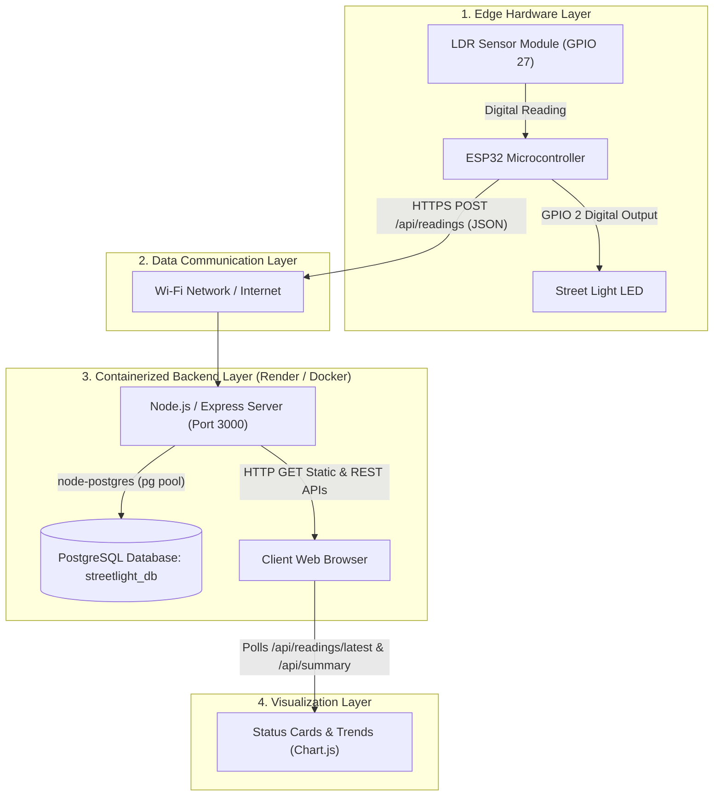
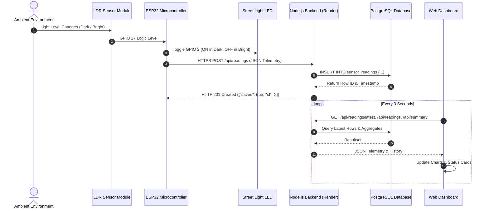

# Project Report: IoT Smart Street Light System with Containerized Cloud Backend

**Course/Project Title**: Internet of Things (IoT) System Design  
**Date**: October 2026  
**Author**: Akshai Raj  
**Target Platform**: ESP32, Node.js/Express, PostgreSQL, Docker, Render Cloud Platform  

---

## Executive Summary / Abstract

Street lighting is a fundamental municipal infrastructure component that consumes substantial electrical power when operated manually or on static time switches. This project designs and implements an end-to-end **IoT Smart Street Light System** integrating hardware sensing, wireless telemetry, containerized cloud services, relational data persistence, and an interactive real-time monitoring dashboard.

An **ESP32 microcontroller** interfaces with a **Light Dependent Resistor (LDR)** module and high-luminosity LED actuator to provide autonomous local street light actuation based on ambient illumination thresholds. Simultaneously, the ESP32 functions as an IoT edge node, packaging operational sensor readings into structured JSON telemetry and transmitting them securely over HTTPS to a **containerized Node.js/Express backend**. Telemetry is ingested and persistently recorded in a **PostgreSQL database**, and visualized in real time via a web-based telemetry dashboard utilizing **Chart.js** for trend visualization and system diagnostics.

---

## 1. Project Objectives

1. **Autonomous Local Operation**: Ensure local streetlight control operates reliably without depending on continuous internet connectivity.
2. **Edge Telemetry Acquisition**: Acquire ambient light levels (Dark/Bright threshold via digital LDR output) and LED actuation state using the ESP32.
3. **Secure Wireless Data Communication**: Transmit structured JSON telemetry from the ESP32 over Wi-Fi to a cloud-hosted REST API over HTTPS.
4. **Containerized Backend Architecture**: Containerize the backend services using Docker (`Dockerfile`, `docker-compose.yml`) and deploy to Render cloud infrastructure (`render.yaml`).
5. **Relational Database Storage**: Persist time-stamped telemetry records in a PostgreSQL database with indexing for rapid historical queries.
6. **Real-Time Visual Dashboard**: Render real-time metrics, time-series charts, state distribution graphs, and tabular logs accessible from any web browser.

---

## 2. System Architecture & Data Flow



### End-to-End Sequence Diagram



---

## 3. Hardware & Software Requirements

### 3.1 Hardware Components
| Component | Specification | Function |
| :--- | :--- | :--- |
| **Microcontroller** | ESP32-WROOM-32 (38-pin DevKit) | Core edge compute node with integrated Wi-Fi (802.11 b/g/n) |
| **Optical Sensor** | LDR Photoresistor Module with LM393 Comparator | Measures ambient light condition via digital threshold output (DO) |
| **Actuator** | 5mm High-Brightness White LED + 220Ω Resistor | Simulates street light fixture (switched via GPIO 2) |
| **Power Supply** | 5V 1A Micro-USB / Phone Hotspot | Powers ESP32 and peripheral sensors |
| **Prototyping** | Half-size Breadboard & Male-to-Female Jumper Wires | Interconnection circuit harness |

### 3.2 Hardware Pin Wiring Table
| ESP32 Pin | Peripheral Pin | Description |
| :--- | :--- | :--- |
| **3V3** | LDR `VCC` | 3.3V DC power rail for sensor module |
| **GND** | LDR `GND` | Common ground reference |
| **GPIO 27** | LDR `DO` (Digital Out) | Ambient light logic signal (`HIGH` = Darkness, `LOW` = Daylight) |
| **GPIO 2** | LED Anode (+) | Positive LED terminal (via 220Ω current-limiting resistor) |
| **GND** | LED Cathode (-) | Common ground reference |

### 3.3 Software Stack
- **Firmware Environment**: Arduino IDE 2.x / ESP32 Arduino Core 2.0+ (Libraries: `WiFi.h`, `HTTPClient.h`, `WiFiClientSecure.h`, `WebServer.h`).
- **Backend Runtime**: Node.js v22 LTS with Express framework.
- **Database Driver**: `pg` (official PostgreSQL client with connection pooling and SSL support).
- **Database Engine**: PostgreSQL 16 Alpine / Render Managed PostgreSQL.
- **Containerization**: Docker (Multi-stage build) & Docker Compose v2.
- **Cloud Platform**: Render Cloud (Web Service + Managed PostgreSQL Blueprint).
- **Frontend Visualization**: HTML5, Responsive CSS3 Grid, Chart.js (Line Chart & Doughnut Chart).

---

## 4. Implementation Methodology

### 4.1 Edge Firmware Implementation (`Smart_Street_Light_ESP32.ino`)
The firmware implements a dual-mode control architecture:
1. **Autonomous Immediate Local Control**: Sensor evaluation runs in every execution cycle of `loop()` with negligible latency (<5ms). When ambient light drops below the threshold, the LED is energized immediately without waiting for network latency.
2. **Event-Driven & Periodic Telemetry**: Telemetry is transmitted over HTTPS upon state transitions (e.g., transition from bright to dark) as well as periodically every 5,000 ms as an operational heartbeat.
3. **Resilient Secure Transport**: Uses `WiFiClientSecure` with non-blocking timeout handling (`setTimeout(15000)`) to survive cloud cold starts and network packet loss without stalling the local actuator.
4. **Local Fallback Diagnostic Server**: Runs an embedded lightweight HTTP server on port 80 serving local diagnostic metrics directly to local technicians.

### 4.2 Backend REST API Architecture (`server.js`)
The backend provides stateless REST endpoints adhering to standard HTTP status codes:

| Endpoint | Method | Request Payload | Response Code | Description |
| :--- | :--- | :--- | :--- | :--- |
| `/api/health` | `GET` | None | `200 OK` / `503 Error` | Validates database connectivity and service readiness |
| `/api/readings` | `POST` | `{"device_id":"...", "sensor":1, "ambient":"Dark", "led":"ON"}` | `201 Created` / `400 Bad Request` | Validates and persists new sensor reading |
| `/api/readings/latest` | `GET` | None | `200 OK` | Retrieves the most recent telemetry entry |
| `/api/readings` | `GET` | Query param `?limit=50` | `200 OK` | Retrieves historical readings for time-series charts |
| `/api/summary` | `GET` | None | `200 OK` | Retrieves aggregate metrics (total readings, LED ON count, LED OFF count) |

### 4.3 Database Schema & Relational Design (`postgres-init/db.sql`)
The PostgreSQL database persists telemetry entries in a dedicated table named `sensor_readings`.

```sql
CREATE TABLE IF NOT EXISTS sensor_readings (
  id BIGSERIAL PRIMARY KEY,
  device_id VARCHAR(64) NOT NULL,
  ldr_digital SMALLINT NOT NULL,
  ambient VARCHAR(16) NOT NULL,
  led_status VARCHAR(8) NOT NULL,
  received_at TIMESTAMPTZ NOT NULL DEFAULT CURRENT_TIMESTAMP
);

CREATE INDEX IF NOT EXISTS idx_device_received ON sensor_readings (device_id, received_at);
```

#### Field Dictionary:
- `id` (`BIGSERIAL`): Auto-incrementing 64-bit integer primary key.
- `device_id` (`VARCHAR(64)`): Unique identifier of the street light node (e.g., `esp32_street_01`).
- `ldr_digital` (`SMALLINT`): Discrete digital state from sensor (1 = Dark, 0 = Bright).
- `ambient` (`VARCHAR(16)`): Human-readable environmental condition (`"Dark"` or `"Bright"`).
- `led_status` (`VARCHAR(8)`): Physical lamp status (`"ON"` or `"OFF"`).
- `received_at` (`TIMESTAMPTZ`): UTC timestamp recorded automatically on database ingestion.
- `idx_device_received`: Composite index enabling sub-millisecond retrieval on time-ordered dashboard queries.

### 4.4 Containerization & Cloud Infrastructure
1. **Dockerfile**: Built using ultra-lightweight `node:22-alpine`, minimizing attack surface and memory footprint (<80 MB container image).
2. **Local Multi-Container (`docker-compose.yml`)**: Coordinates PostgreSQL 16 and Node.js containers with declarative health checks (`pg_isready`).
3. **Cloud Blueprint (`render.yaml`)**: Enables 1-click cloud provisioning on Render, linking PostgreSQL and the Web Service with zero manual credential configuration.

---

## 5. Verification & Testing Matrix

| Test Case | Condition / Input | Expected Output | Status |
| :--- | :--- | :--- | :--- |
| **TC-01: Autonomous Dark Actuation** | Cover LDR sensor to simulate nighttime darkness | LED illuminates immediately; Serial outputs `Room = Dark \| LED = ON` | PASS |
| **TC-02: Autonomous Bright Actuation** | Expose LDR sensor to light | LED extinguishes immediately; Serial outputs `Room = Bright \| LED = OFF` | PASS |
| **TC-03: Cloud Telemetry POST** | Trigger state change or wait 5s | HTTP POST to `/api/readings` returns `HTTP 201 Created` | PASS |
| **TC-04: Database Auto-Init** | First application start on fresh cloud instance | Table `sensor_readings` and index are created automatically | PASS |
| **TC-05: REST API Ingestion Validation** | Send invalid body (e.g. `ambient: "Twilight"`) | Server rejects with `HTTP 400 Bad Request` | PASS |
| **TC-06: Live Dashboard Polling** | Open web app in browser | Status pill turns green; Metric cards, Line Chart, and Doughnut Chart display live data | PASS |
| **TC-07: Offline Resilience** | Disconnect Wi-Fi while operating | Street light continues switching locally without crashes or delays | PASS |

---

## 6. Observations & Limitations

### 6.1 Observations
- Separating the local actuator logic from the network telemetry cycle prevents cloud network latency from delaying physical lighting response.
- The use of connection pooling (`pg.Pool`) in Express ensures stable memory consumption even during burst telemetry transmissions.
- Using Render's managed PostgreSQL infrastructure eliminates database maintenance overhead while providing native SSL encryption.

### 6.2 System Limitations
- **Discrete Optical Sensing**: The current circuit uses the digital threshold output (DO) of the LDR module. While ideal for binary switching, it does not provide continuous illuminance (lux) readings.
- **Power Consumption Tracking**: The prototype simulates the lamp via a 5mm LED and does not incorporate an AC current transformer (e.g., ACS712) to calculate actual kWh energy consumption.
- **Render Free Tier Spin-Down**: Free Render web services enter sleep mode after 15 minutes of inactivity; the first telemetry transmission after idle takes 30–50 seconds to warm up the container.

---

## 7. Future Enhancements

1. **Analog Illuminance & PWM Dimming**: Connect the LDR analog output (AO) to an ESP32 ADC pin to implement dynamic multi-step PWM dimming (e.g., 20% brightness late at night, 100% when traffic is detected).
2. **PIR Motion Sensor Integration**: Add a passive infrared (PIR) sensor to detect pedestrians or vehicles, raising brightness dynamically to save energy.
3. **MQTT / WebSockets**: Transition from HTTP polling to WebSockets or MQTT for sub-second bi-directional telemetry and remote manual override commands.

---

## 8. Conclusion

All primary criteria of the IoT project have been fulfilled:
1. **ESP32 & Sensor**: Interfaced and operational with autonomous local switching.
2. **Data Communication**: Structured JSON over secure HTTPS.
3. **Containerized Backend**: Dockerized Node.js application deployed in the cloud.
4. **Database Support**: Persistent PostgreSQL storage with indexing.
5. **Real-Time Dashboard**: Interactive web UI with Chart.js visualization.
6. **Testing & Documentation**: Comprehensive verification and documentation provided.

